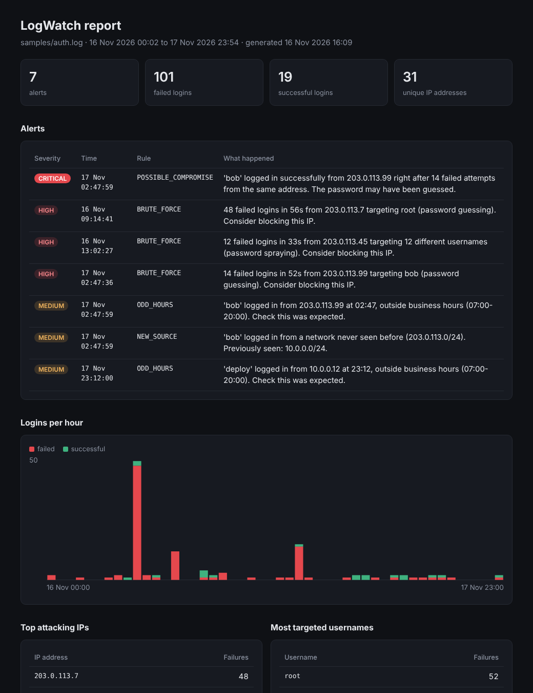

# LogWatch


**Spot attacks on a small business server without a security team.**

Small businesses run servers that face password-guessing attacks every day, and most have no one watching the logs. LogWatch is a lightweight Python tool that reads a server's SSH login log, flags suspicious activity, and explains it in plain English: in the terminal, by email, or as a one-page dashboard.



```
$ logwatch scan samples/auth.log --report report.html
LogWatch 1.0.0: parsed 120 SSH login events from samples/auth.log
[CRITICAL] 2026-11-17 02:47:59  POSSIBLE_COMPROMISE    'bob' logged in successfully from 203.0.113.99 right after 14 failed attempts from the same address. The password may have been guessed.
[HIGH    ] 2026-11-16 09:14:41  BRUTE_FORCE            48 failed logins in 56s from 203.0.113.7 targeting root (password guessing). Consider blocking this IP.
[HIGH    ] 2026-11-16 13:02:27  BRUTE_FORCE            12 failed logins in 33s from 203.0.113.45 targeting 12 different usernames (password spraying). Consider blocking this IP.
[MEDIUM  ] 2026-11-17 23:12:00  ODD_HOURS              'deploy' logged in from 10.0.0.12 at 23:12, outside business hours (07:00-20:00). Check this was expected.
...
Dashboard written to report.html
```

## What it detects

| Rule | Severity | What it means | How it works |
|---|---|---|---|
| `BRUTE_FORCE` | High | Someone is guessing passwords | 10+ failed logins from one IP within 60 seconds (sliding window). Reports one alert per attack with the final count, and tells **password guessing** (one username) apart from **password spraying** (many usernames). |
| `POSSIBLE_COMPROMISE` | Critical | The guessing may have worked | A *successful* login from an IP that had 5+ failures in the previous hour. |
| `ODD_HOURS` | Medium | A login nobody expected | A successful login outside business hours (07:00–20:00 by default, optionally weekends). |
| `NEW_SOURCE` | Medium | A login from somewhere new | A user logs in from a network (/24 for IPv4) they have never used before. Known networks are remembered between runs. |

All thresholds can be changed in a config file: see [`logwatch.example.toml`](logwatch.example.toml). These map to MITRE ATT&CK [T1110 Brute Force](https://attack.mitre.org/techniques/T1110/) and [T1078 Valid Accounts](https://attack.mitre.org/techniques/T1078/).

## Quick start

```bash
git clone https://github.com/isha0404/logwatch.git
cd logwatch
python -m venv .venv && source .venv/bin/activate      # Windows: .venv\Scripts\activate
pip install -e ".[dev]"

logwatch scan samples/auth.log --year 2026 --report report.html   # try it on the fake sample log
pytest                                                           # run the 41 tests
```

On a real Linux server (the log is readable only by root or the `adm` group):

```bash
sudo logwatch scan /var/log/auth.log --report report.html --state ~/.logwatch-state.json   # Debian/Ubuntu
sudo logwatch scan /var/log/secure --report report.html                                     # RHEL/Fedora
sudo logwatch follow /var/log/auth.log --email        # watch live, alert as it happens
```

### Commands

| Command | What it does |
|---|---|
| `logwatch scan FILE` | Analyse a log once. Exit code `0` = nothing found, `1` = alerts, `2` = error, so it works from cron. |
| `--report report.html` | Write the dashboard (one self-contained file: no internet or JavaScript needed). |
| `--json alerts.json` | Write alerts as JSON for other tools. |
| `--state state.json` | Remember each user's usual networks between runs (for `NEW_SOURCE`). |
| `--config logwatch.toml` | Use custom thresholds. |
| `logwatch follow FILE` | Watch the log live like `tail -F`, coping with log rotation. |
| `--email` | Send a plain-English digest email (see below). |

### Email alerts

Credentials are read from environment variables and never stored in code or config:

```bash
export LOGWATCH_SMTP_HOST=smtp.gmail.com LOGWATCH_SMTP_PORT=587
export LOGWATCH_SMTP_USER=you@example.com LOGWATCH_SMTP_PASSWORD='app-password'
export LOGWATCH_EMAIL_FROM=you@example.com LOGWATCH_EMAIL_TO=owner@example.com
logwatch scan /var/log/auth.log --email
```

The connection is always upgraded to TLS before logging in.

### Docker

```bash
docker build -t logwatch .
docker run --rm -v /var/log/auth.log:/logs/auth.log:ro -v logwatch-state:/data \
  logwatch scan /logs/auth.log --state /data/state.json
```

The container runs as a non-root user and mounts the log **read-only**.

## How it works

```
auth.log ──► parser.py ──► LoginEvent ──► detectors.py (Engine) ──► Alert ──► terminal / email / JSON
                                                         │
                                                         └──► report.py (pandas) ──► report.html
```

- **`parser.py`**: regular expressions with named groups turn each raw line into a `LoginEvent` (time, user, IP, outcome). It handles both syslog (`Nov 16 09:14:31`) and ISO timestamps, IPv4 and IPv6, and `invalid user` lines. It also handles the year rolling over from December to January, which matters because syslog timestamps don't include a year. Anything it doesn't recognise is skipped, never crashed on.
- **`detectors.py`**: each rule processes **one event at a time**, so exactly the same code powers a one-off `scan` and live `follow` mode. Brute force uses a `collections.deque` per IP as a sliding window: append the new failure, drop anything older than the window, check the length. That's O(1) per line, so large logs are fast.
- **`alerts.py`**: the `Alert` dataclass, terminal output, JSON, and the email digest with "what to do next" advice.
- **`report.py`**: pandas groups events by hour and counts the top attacking IPs and usernames. The page is plain HTML with an inline SVG chart.
- **`cli.py`**: `argparse` sub-commands, friendly error messages, and the `tail -F`-style follower that notices when the log is rotated.

### Security decisions

- **Attacker-controlled text is escaped.** Usernames in failed logins are typed by the attacker, so the dashboard HTML-escapes everything. There's a test that tries `<script>` as a username.
- **No secrets in code.** SMTP credentials come only from environment variables, and `.env` is git-ignored.
- **Least privilege.** The Docker image runs as an unprivileged user with the log mounted read-only.
- **No real data in the repo.** The sample log is generated by [`scripts/generate_sample_log.py`](scripts/generate_sample_log.py) using IP ranges reserved for documentation (RFC 5737). `*.log` is git-ignored.
- **Privacy-friendly "location".** `NEW_SOURCE` compares networks rather than sending IPs to a third-party geolocation service.
- **State is saved atomically** (write to a temp file, then rename), so a crash can't corrupt it.

## Limitations and next steps

- Detects only from SSH logs. Web server logs (e.g. nginx) would be a natural next source.
- `NEW_SOURCE` uses networks, not countries. An offline GeoIP database (e.g. MaxMind GeoLite2) would allow "login from a new country".
- Attackers who rotate across many IPs slowly (a distributed attack) can stay under per-IP thresholds. A global failure-rate rule would catch that.
- LogWatch alerts but doesn't block. It pairs well with fail2ban or a firewall rule.

## Project layout

```
src/logwatch/      parser, detectors, alerts, report, config, cli
tests/             41 pytest tests (parser, each rule, CLI, report, email with a mocked SMTP server)
samples/auth.log   fake log with planted attacks
scripts/           sample log generator
docs/              dashboard screenshot and example report
.github/workflows  CI: tests on Python 3.11-3.13 plus a Docker build
```

## License

MIT © Isha Inani
